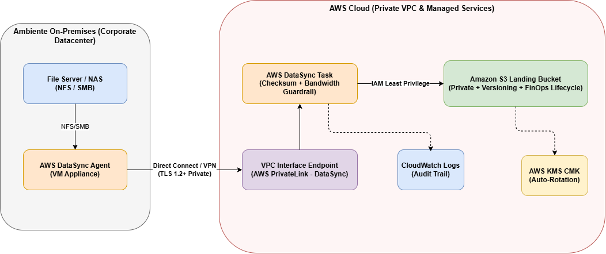

# AWS Self-Service Data Transfer Blueprint (Terraform)

Blueprint corporativo de **Infrastructure as Code (Terraform)** para padronização, governança e entrega *Self-Service* de fluxos críticos de transferência e ingestão de dados na AWS utilizando **AWS DataSync**, **Amazon S3**, **AWS KMS** e controles nativos de **FinOps** e **Zero Trust**.

## Arquitetura & Documentação Técnica



* **[HLD / LLD (High-Level & Low-Level Design)](./docs/HLD-LLD-data-transfer.md):** Especificação arquitetural completa, fluxos de rede privada e guardrails corporativos.
* **[ADR-001 (Architecture Decision Record)](./docs/ADR-001-datasync-vs-custom-scripts.md):** Justificativa técnica da adoção do AWS DataSync frente a scripts customizados e SFTP.

## Guardrails Embutidos (By Design)
* **Segurança & Zero Trust:** Bloqueio de acesso público no S3, política obrigatória de transporte TLS (`aws:SecureTransport`), criptografia KMS CMK com rotação anual e IAM Role com privilégio mínimo restrito à conta de origem.
* **FinOps:** Habilitação de **S3 Bucket Keys** (redução de até 99% nos custos de requisições KMS), transição automática de camadas de armazenamento (*Standard-IA* e *Glacier Instant Retrieval*) e limitação de banda (`bytes_per_second`) para evitar saturação de links híbridos.
* **Auditoria & Compliance:** Logs detalhados no CloudWatch Logs criptografados com KMS e validação automática de checksum ponta a ponta.

## Como Utilizar (Self-Service)

```bash
cd Terraform
cp terraform.tfvars.example terraform.tfvars
# Edite terraform.tfvars com os parâmetros do fluxo
terraform init
terraform plan
